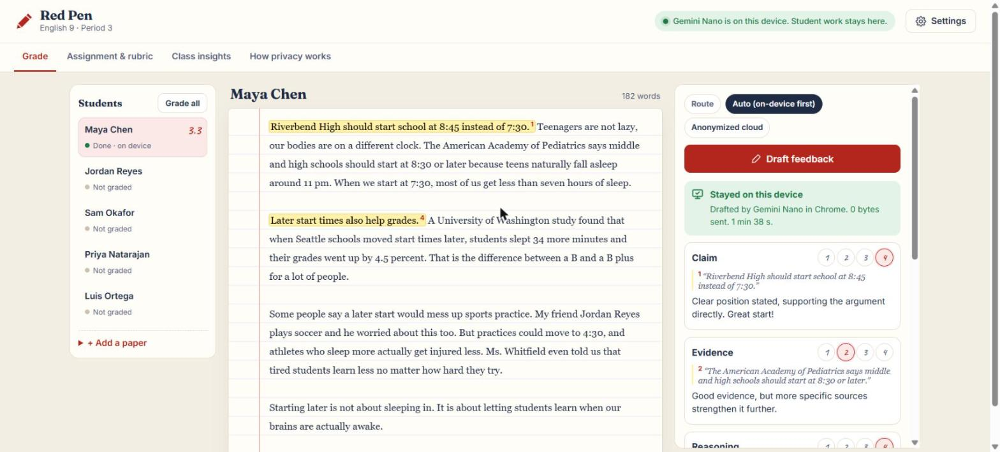

# Red Pen

**Private grading help for teachers.** Red Pen drafts rubric feedback on student writing with Gemini Nano running inside Chrome, so student work stays on the teacher's computer. When a device can't run a local model, the paper is anonymized on the device first, and only the anonymized copy goes to the cloud.

Built for the #BuildHybridAI challenge with **Firebase AI Logic hybrid inference**.

**Try it:** https://red-pen-9fce1.web.app (Chrome on a desktop or laptop; every student in the demo class is fictional)

**Demo video:** https://youtu.be/-48kci7c6vI



## The problem

Teachers spend hours every week writing feedback on essays. AI could give some of those hours back, but student work is protected by FERPA, and many districts tell teachers not to paste it into AI tools. So the teachers who need the help most are the ones told not to use it.

Hybrid inference fixes this, as long as the app is strict about where each request is allowed to run.

## How the routing works

Red Pen picks an inference mode for each kind of request instead of letting fallback decide:

| Request | Holds student data? | Mode | What happens |
|---|---|---|---|
| Draft feedback on a paper | Yes | `ONLY_ON_DEVICE` | Gemini Nano runs in Chrome. Zero bytes leave the laptop. Works offline. |
| Same, on a device that can't run Nano | Yes | redact locally, then `ONLY_IN_CLOUD` | Names, teacher, school, emails, phones, IDs, addresses and dates become placeholders like `[STUDENT]` before anything is sent. Names are put back on the device afterwards. |
| Draft a rubric from a prompt | No | `PREFER_IN_CLOUD` | Uses the larger cloud model when online and falls back to the on-device model when offline. |
| Class insights (patterns, mini-lesson, practice) | No (anonymized scores only) | `PREFER_IN_CLOUD` | Same as above. |

Red Pen **never** uses `PREFER_ON_DEVICE` for student work. If the local model failed, that mode would quietly send the real paper, names included, to the cloud. Instead, the app checks `LanguageModel.availability()` and chooses the route itself.

On-device speed depends on the laptop. Red Pen streams the draft and shows each criterion as it is scored. If the local model stops making progress (nothing new for 30 seconds), Red Pen falls back to the anonymized route, never to the raw paper, and the receipt says why.

The JSON schema is built from the teacher's rubric (exactly one entry per criterion, names fixed), so the small on-device model can't skip or rename a criterion.

Every result shows a **privacy receipt**: either "Stayed on this device, 0 bytes sent", or "Anonymized here, then sent", with a button that shows the exact text the cloud received.

## Features

- Rubric scores (1 to 4) for each criterion, each with a quoted line from the paper as evidence. The quote is highlighted in the paper.
- A glow, a grow and a short note to the student, in a tone and reading level the teacher picks.
- Everything is editable: score buttons, comments and the note. The teacher stays in charge.
- Grade one paper or the whole class.
- AI-drafted rubrics from an assignment prompt.
- Class insights: shared patterns, a 10-minute mini-lesson and practice at three levels, built only from anonymized scores.
- Works offline once the model is downloaded (installable PWA with a service worker).
- Keyboard-accessible tabs, reduced-motion support and responsive layout.

## Built with

- **Firebase AI Logic** (Web SDK 13.3) with hybrid inference: `getGenerativeModel(ai, { mode, onDeviceParams, inCloudParams })`
- **Gemini Nano** in Chrome through the Prompt API, with structured JSON output (`responseConstraint`)
- **Gemini 3.5 Flash-Lite** in the cloud (Gemini Developer API), with the same JSON schema (`responseJsonSchema`)
- **Firebase App Check** with Fraud Defense (reCAPTCHA Enterprise), so only Red Pen can call the model
- **Firebase Remote Config** for the cloud model name and feedback temperature
- **Firebase Hosting**
- Plain HTML, CSS and JavaScript modules. No build step.

## Project layout

```
index.html              app shell
css/app.css             styles
js/ai.js                Firebase AI Logic setup, routing, schemas
js/privacy.js           on-device redaction and restore
js/app.js               UI
js/demo.js              fictional demo class (every name is made up)
js/firebase-config.js   public Firebase web config
sw.js                   offline cache
```

## Run it locally

1. Serve the folder with any static server, for example:
   ```bash
   python -m http.server 8792
   ```
2. Open `http://localhost:8792` in Chrome 138 or newer on a desktop.
3. To try the on-device route, click **Download** in the status pill (Chrome downloads Gemini Nano once). Without it, Red Pen uses the anonymized cloud route.

## Use your own Firebase project

1. Create a Firebase project and add a web app.
2. In **AI Logic**, choose the Gemini Developer API.
3. In **App Check**, register the web app with Fraud Defense (reCAPTCHA Enterprise). Add `localhost` and your hosting domain to the key.
4. Copy `js/firebase-config.example.js` to `js/firebase-config.js` and fill in your web config and site key. That file is git-ignored; restrict the API key to your own domains in Google Cloud.
5. Optional: add Remote Config parameters `cloud_model` (string) and `feedback_temperature` (number).

## Privacy notes

- Papers and grades are stored only in the browser's localStorage. There is no server and no database.
- Redaction is a safety layer, not a guarantee. It catches names from the roster and settings and common patterns (emails, phone numbers, IDs, addresses, dates). Teachers can add their own private words in Settings.
- AI monitoring is turned off in the Firebase project, so prompts are not logged.

## License

[Apache 2.0](LICENSE)
